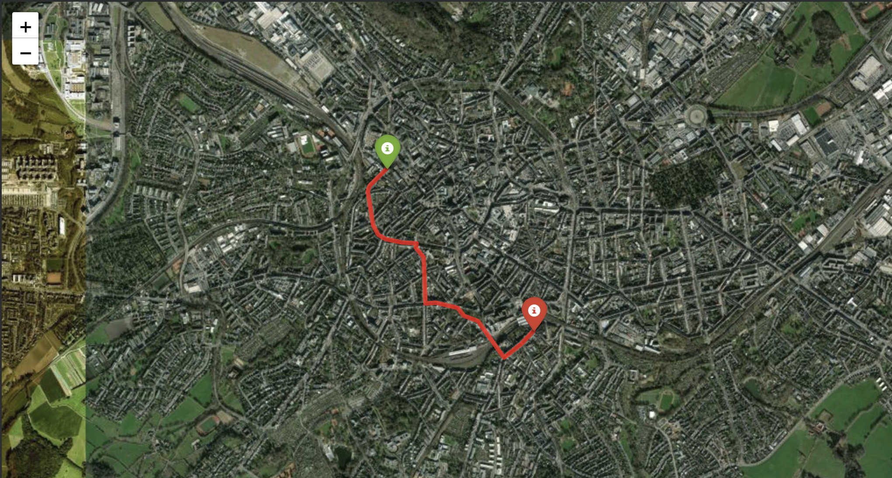

# Navigation Route Finder · Aachen

**Shortest driving routes through the real street network of Aachen, computed with a hand-written Dijkstra algorithm on OpenStreetMap data.**



## Abstract

This project builds a small navigation system from scratch. The street network of Aachen is downloaded from OpenStreetMap with OSMnx and modelled as a directed graph: intersections are nodes, street segments are edges weighted by their length in metres, and one-way streets are respected. Two addresses are geocoded with Nominatim and snapped to the nearest intersections. Dijkstra's algorithm, implemented with a priority queue and cross-checked against NetworkX, then finds the shortest route between them. The result is drawn on an interactive Folium map along the real street geometry, with start and end markers and a choice of base maps. The figure shows an example: the shortest driving route from the RWTH main building to Aachen Hauptbahnhof on the satellite base map.

## How it works

| Step | Tool | Result |
|---|---|---|
| 1 · Street network | OSMnx | directed graph of all drivable streets, cached as GraphML |
| 2 · Geocoding | Nominatim (geopy) | address → latitude / longitude |
| 3 · Snapping | OSMnx | coordinates → nearest intersection |
| 4 · Shortest path | own Dijkstra (heapq) | route + length, verified with NetworkX |
| 5 · Visualisation | Folium | interactive map with route, markers, base map styles |

## Run it

```bash
pip install osmnx networkx geopy folium matplotlib
jupyter notebook navigation_route_finder.ipynb
```

Set `START_ADDRESS` and `END_ADDRESS` in the config cell. The first run downloads the street network (about a minute); afterwards it is loaded from the cache.

## Limitations and next steps

- Optimises **distance, not travel time**: speed limits via `ox.add_edge_travel_times` would make it a "fastest route" finder.
- Routes start and end at the **nearest intersection**, not the exact address.
- Only the network **inside the city boundary** is loaded.
- **A\*** with a straight-line heuristic would explore far fewer intersections on long routes.

*Started as a Streamlit web app; this notebook is the cleaned-up version.*
